### **Диаграмма использования**

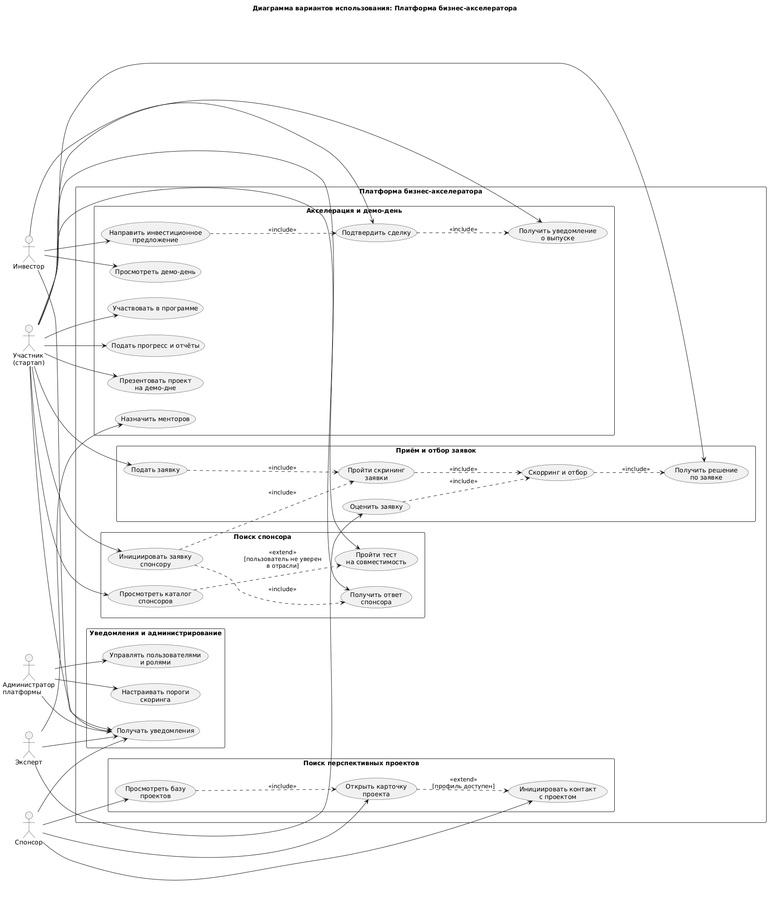

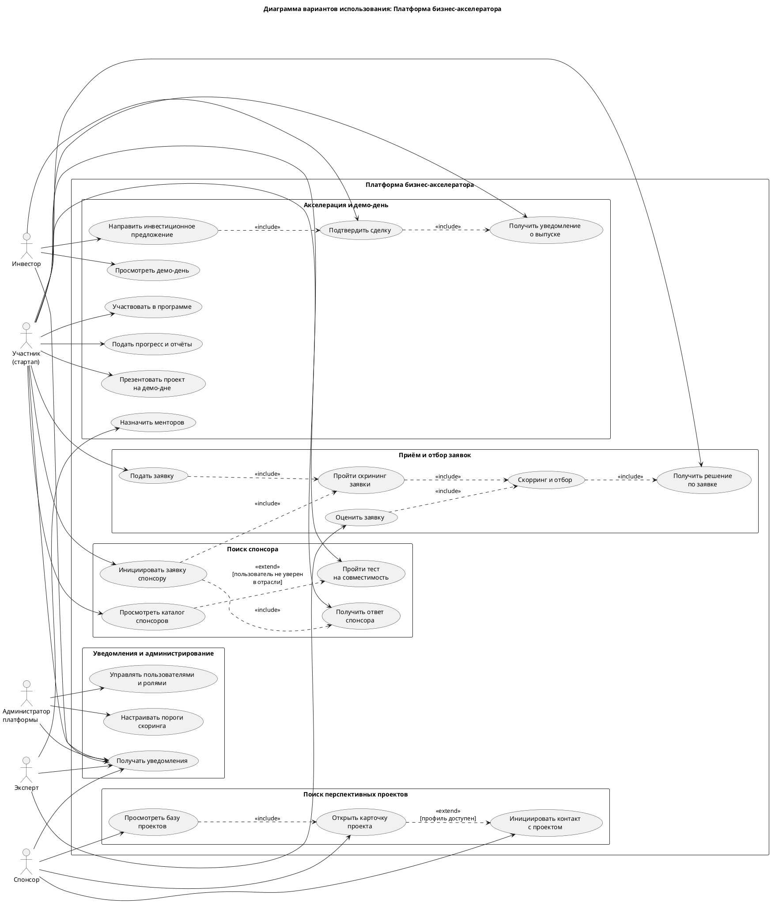

### **Диаграмма использования с уклоном в техническую часть**

В данный момент не реализовано!!!

### **Диаграмма последовательности приёма заявок**

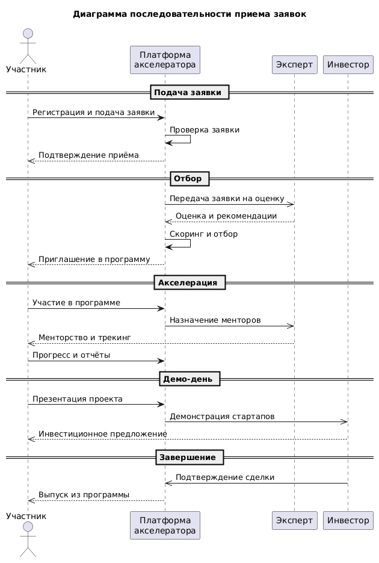

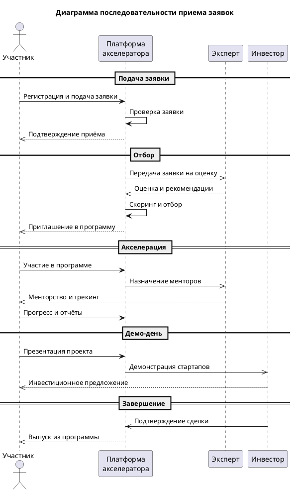

### **Диаграмма последовательности отбора заявок**

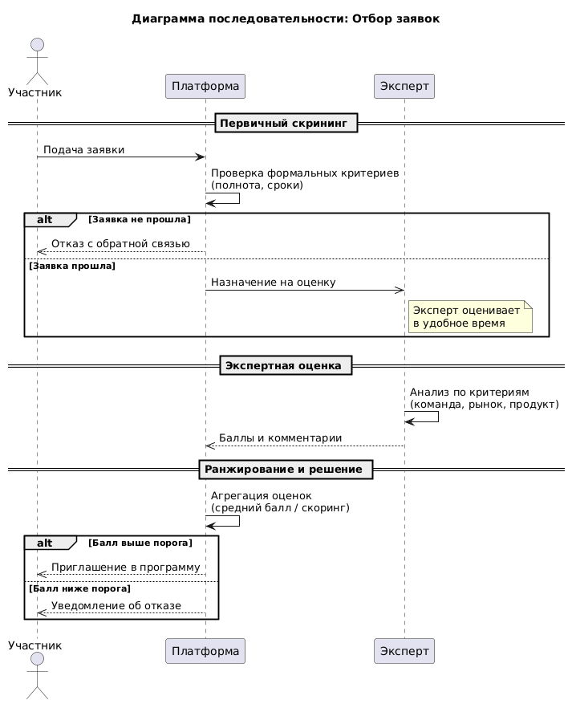

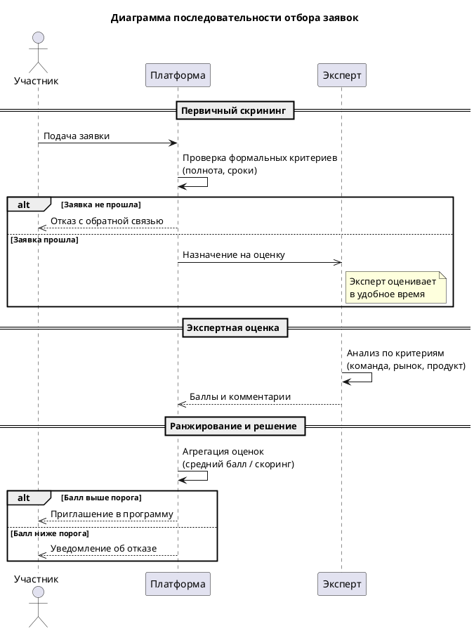

### **Диаграмма состояний поиска спонсора**

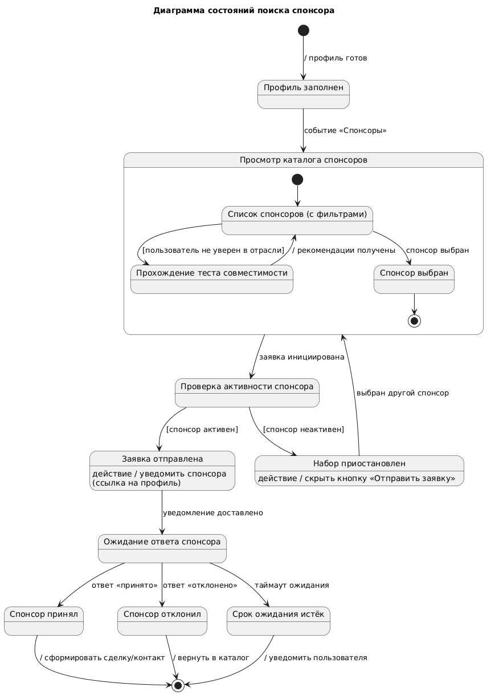

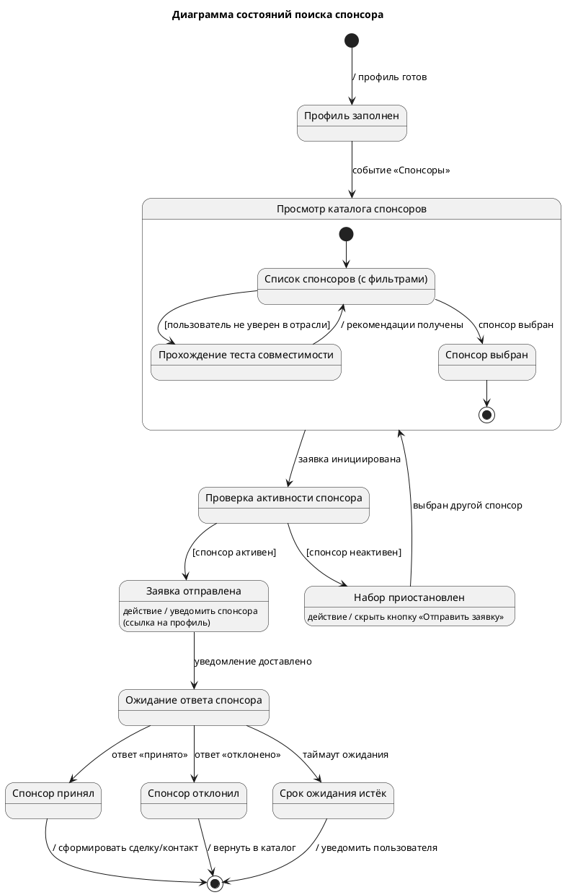

### **Диаграмма состояний поиска проектов**

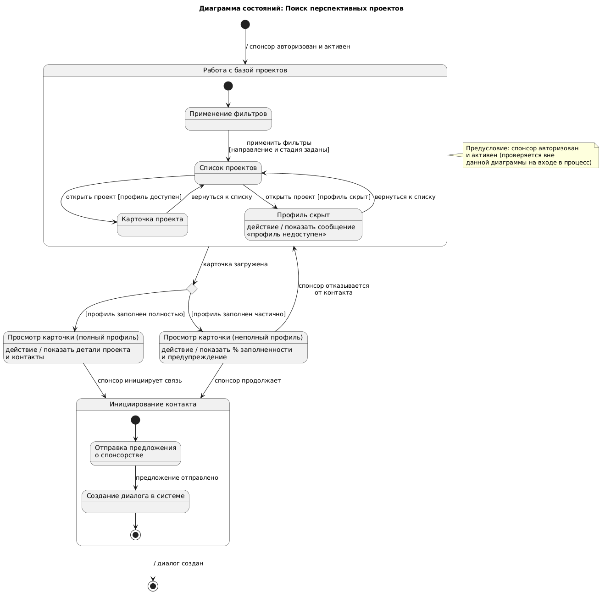

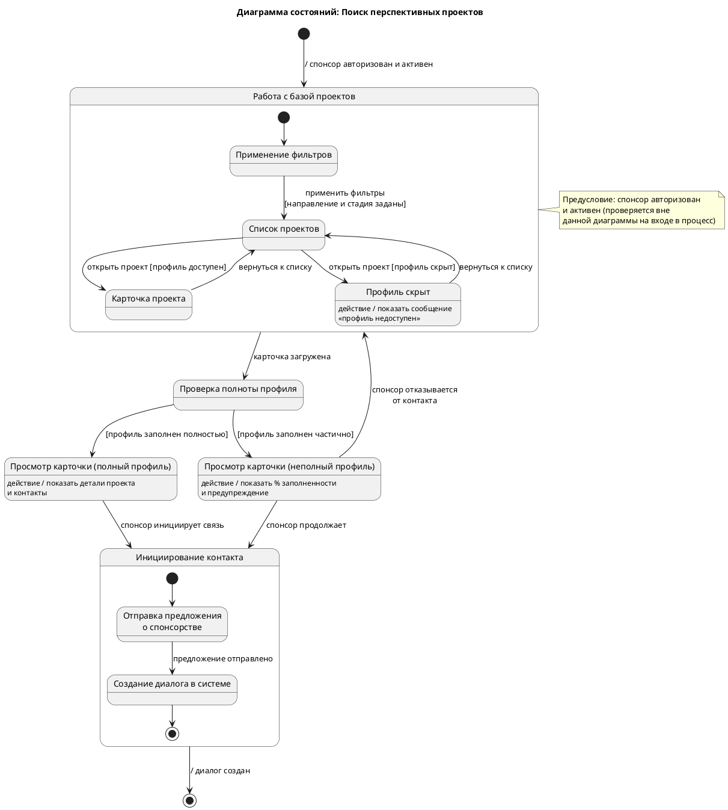

### **Диаграмма деятельности поиска спонсоров**

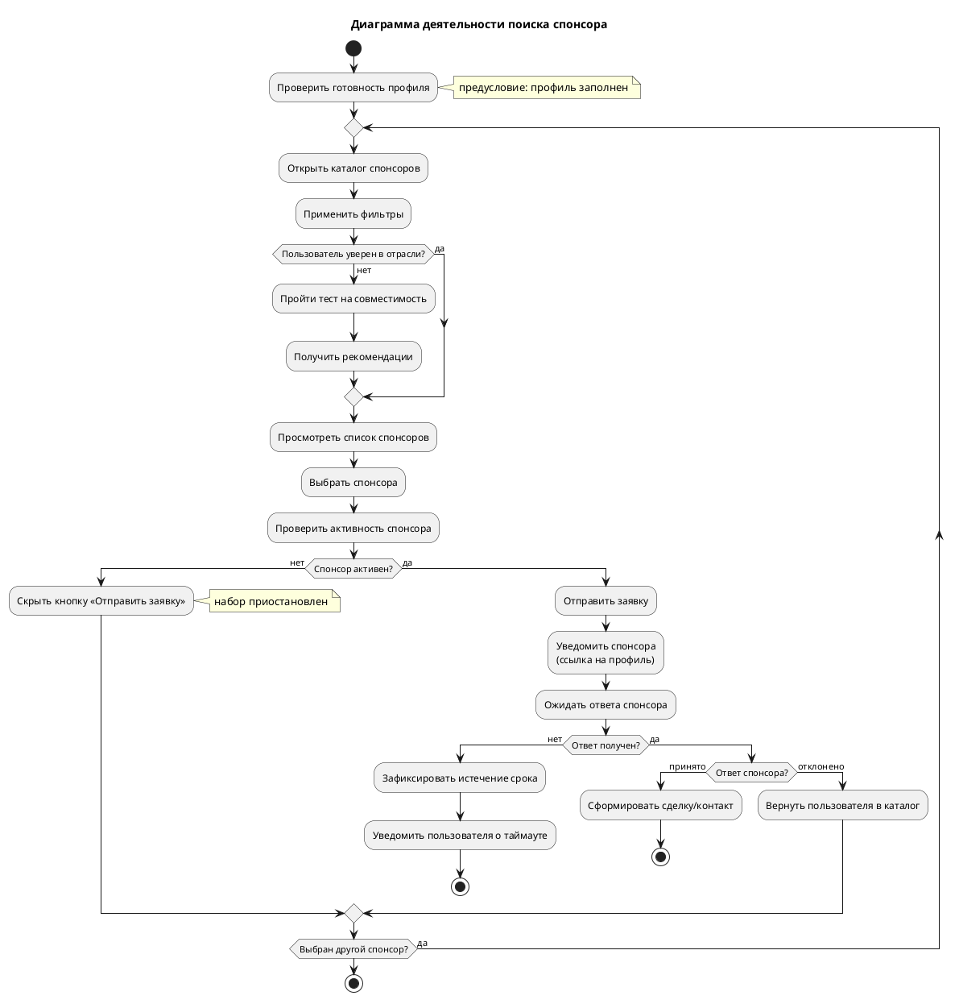

### **Диаграмма деятельности поиска проектов**

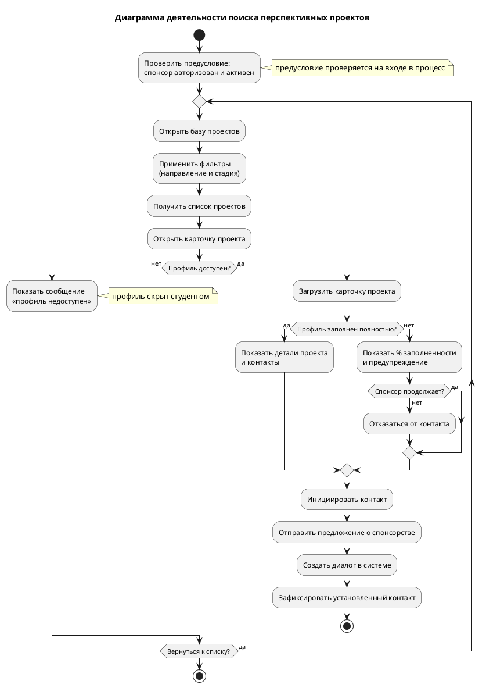